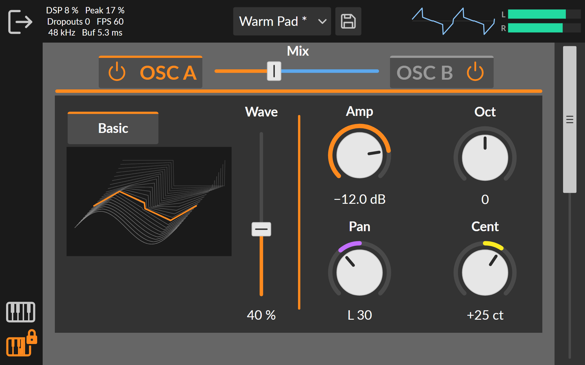

# Project X

An Android synthesizer for tablets (landscape only, designed for 1920×1200), made for personal use.
The sound engine is written in [Faust](https://faust.grame.fr/), audio output runs through
[Oboe](https://github.com/google/oboe), and the interface is drawn in Kotlin with Jetpack Compose.



*The v0.10 screen with the keyboard hidden, rendered with the same measurements and colors as the
app (`docs/teken_scherm.py`).*

## About this project

Project X is purely a hobby project. It explores what is possible when an app is built with the
help of AI: the code is written by an AI assistant (Claude), while the design, the choices and
the testing on a real tablet are done by me.

## Status

**Project X is in active development.** What is here now is an early stage: many parts are
still to come, including:

- effects
- a sequencer
- a mixer
- a sampler
- filters, envelopes and modulation

Features, the interface and the file formats (such as presets) may still change between versions.

## Features (v0.10)

- Monophonic, with two wavetable oscillators (Osc A and Osc B), each with 8 wavetables.
- Per oscillator: Wave (position in the wavetable), Amp, Oct, Cent and Pan, in stereo.
- Equal-power mix between A and B.
- Two-octave on-screen keyboard with latch.
- Oscilloscope, VU meter and DSP load meter.
- Presets: save, overwrite, rename and delete.

The project history is in [docs/ProjectX-logboek.html](docs/ProjectX-logboek.html) and the working
agreements are in [CLAUDE.md](CLAUDE.md), both in Dutch. The commit hashes in the logbook refer
to the local history from before this public version; on GitHub the history starts at v0.10.

## Folders

| Folder | Contents |
|---|---|
| `app/src/main/faust/` | The sound engine in Faust (`voice.dsp`) |
| `app/src/main/cpp/` | C++ engine and the Oboe audio output |
| `app/src/main/java/` | User interface (Kotlin/Compose) |
| `app/src/main/assets/` | `wavetables.bin`, the app's wavetables |
| `design/` | GUI designs (Inkscape SVG) |
| `tools/dsp-test/` | Sound test that runs on a PC |
| `tools/wavetables/` | Converter that builds `wavetables.bin` |
| `docs/` | Logbook |

## Building

You need Android Studio with the NDK and CMake, and the Faust compiler on your path. Then run:

```
gradlew assembleDebug
```

## License

Project X is licensed under the **GNU General Public License version 3** (see [LICENSE](LICENSE)),
because it contains wavetable data from Surge XT.

## Credits

- **Wavetables:** seven of the eight wavetables are converted from
  [Surge XT](https://github.com/surge-synthesizer/surge) (GPL-3.0), from the folder
  `resources/data/wavetables/`:
  - `Generated/PWM.wt` (PWM)
  - `Generated/Saw Sync.wt` (Saw Sync)
  - `Generated/Sine PD HQ.wt` (Sine PD)
  - `Generated/Sine FM 2x HQ.wt` (Sine FM 2x)
  - `Generated/Formants.wt` (Formants)
  - `Generated/Sawtooth Reso.wt` (Saw Reso)
  - `Sampled/Vocal O Formant 2.wt` (Vocal O)

  They were band-limited and normalized with `tools/wavetables/make_wavetables.py`.
  The "Basic" wavetable is original work.
- **Font:** Lato by Łukasz Dziedzic, SIL Open Font License 1.1
  (see [licenses/OFL-Lato.txt](licenses/OFL-Lato.txt)).
- **Faust skill** in `.claude/skills/faust/`: by Julius O. Smith III, MIT License
  (see the `LICENSE` file in that folder).
- **Faust libraries** and **Oboe** are used at build time under their own licenses.
